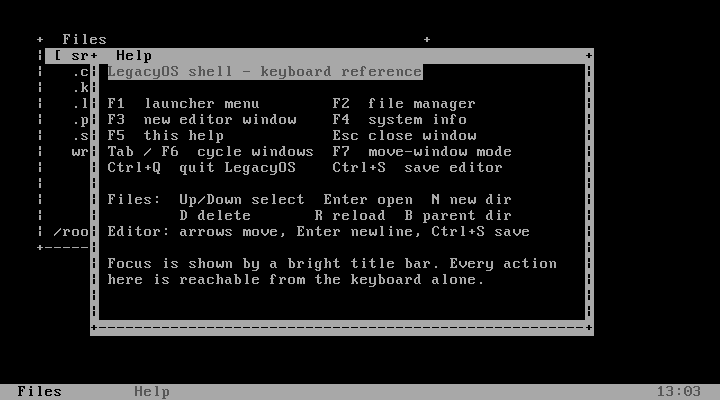
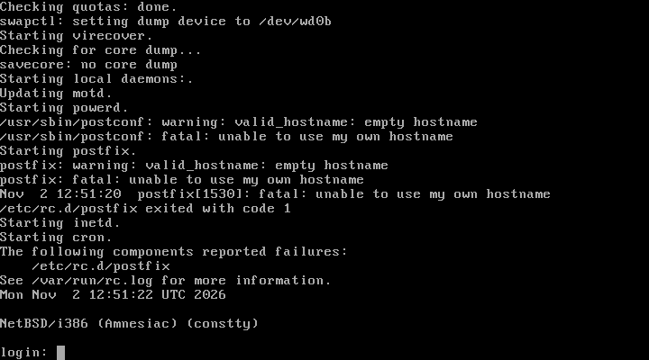
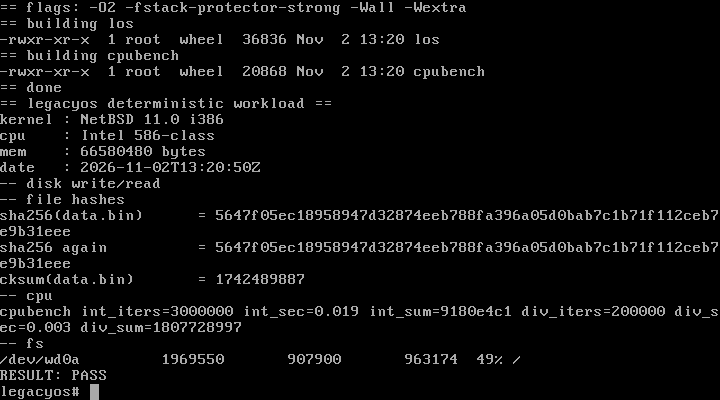

# LegacyOS

A lightweight, modern-feeling operating-system environment for older x86
computers — Pentium-era machines today, with 486-class hardware as an open
question rather than a promise.

**Status: first prototype booted and verified under emulation on 2 November 2026.**
Nothing in this project has been tested on physical hardware, and no release
image is published.

This repository is a **public project showcase**. It documents goals, verified
results and direction. The implementation is developed in a private repository
and is not published here. See [Scope and licensing](#scope-and-licensing).

---

## The problem

Usable computers are thrown away long before they stop working. A machine from
the late 1990s can still type, read and calculate, but the software that runs on
it is either abandoned or too heavy for the hardware. LegacyOS asks a narrow
question: **what is the smallest amount of new work required to give that
hardware a coherent, maintainable, modern-behaving environment?**

## Approach

LegacyOS is a curated system personality on a pinned **NetBSD/i386 11.0** base,
plus original userland work — not a kernel written from scratch:

- A pinned, hash-verified NetBSD 11.0 i386 base from the official ISO
- A defined install profile (13 distribution sets, no X11)
- **Original code**: `los`, a keyboard-driven overlapping-window text desktop,
  and `cpubench`, a deterministic benchmark
- **Original harness**: a headless, reproducible QEMU lab that installs, boots,
  drives and measures the system without human timing

## Verified results

Every row below was observed in the lab and is backed by a captured frame in the
project's evidence archive. Items that were not measured are marked as such
rather than estimated.

| Result | Configuration |
|---|---|
| NetBSD 11.0 i386 installs from a hash-verified ISO | QEMU 11.1.0, `-cpu pentium -m 64`, 2 GB MBR disk |
| Installed system boots to `login:` from disk with no CD attached | Fresh emulator process, no install media |
| Interactive login, file write, orderly ACPI shutdown | root login on `tty`; written and read back |
| Native toolchain builds the original code on the guest | `cc (nb3) 12.5.0`, `-O2 -fstack-protector-strong` |
| Text desktop runs: overlapping windows, taskbar, launcher, file manager | `los`, 80×25 VGA text mode |
| Deterministic workload passes | `sha256` stable across reads, `RESULT: PASS` |
| Pentium III profile reaches `login:` | `-cpu pentium3 -m 128`, clean image |

## What is *not* verified

Stated plainly, because the distinction matters:

- **486-class hardware is unproven.** In emulation the kernel boots and attaches
  its disk, VGA and keyboard devices, but had not reached `login:` after 240 s of
  wall clock — during which the guest's own kernel clock advanced only about one
  second. That is a too-short capture window on a very slow emulated CPU, not a
  demonstrated failure. The roadmap treats 486 support as **promising but
  unproven**.
- **No physical hardware has been tested.** Every result above is from emulation.
- **No modern security guarantees are claimed.** A NetBSD base with
  `-fstack-protector-strong` is not the same thing as a hardened, audited OS, and
  this project does not present it as one.
- Configurations below the NetBSD `GENERIC` kernel's documented RAM floor are
  marked "not tested" and require a custom kernel first.

## Roadmap

| Milestone | State |
|---|---|
| Reproducible emulated install, boot and workload | Reached |
| Original text desktop and benchmark on the guest | Reached |
| Extend the 486 capture window and settle Tier A empirically | Next |
| Custom kernel for 16–24 MB configurations | Planned |
| Physical-hardware bring-up on real Pentium-class machines | Planned, not started |
| Distribution image and install documentation | Planned |

## Intended audience

People maintaining or restoring old x86 hardware, retrocomputing and
computing-history enthusiasts, and anyone interested in minimal computing as a
design discipline rather than a novelty.

## Related work

LegacyOS builds on [NetBSD](https://www.netbsd.org/), which supplies the kernel,
the toolchain and the distribution base. QEMU is used only as a lab instrument.
Everything original to this project — the desktop, the benchmark, the lab
harness and the documentation — is developed in a private repository.

## Scope and licensing

This is a **showcase repository**. It contains documentation, screenshots and
status reporting only:

- No implementation source code is published here.
- The screenshots are of this project's own emulated lab sessions.
- **No open-source licence is granted** for the private implementation work by
  anything in this repository. The absence of a `LICENSE` file is deliberate and
  does not place the code in the public domain.
- Third-party components shown or referenced (NetBSD, QEMU) remain under their
  own licences and are not redistributed here.

See [CHANGELOG.md](CHANGELOG.md) for the public milestone record.
